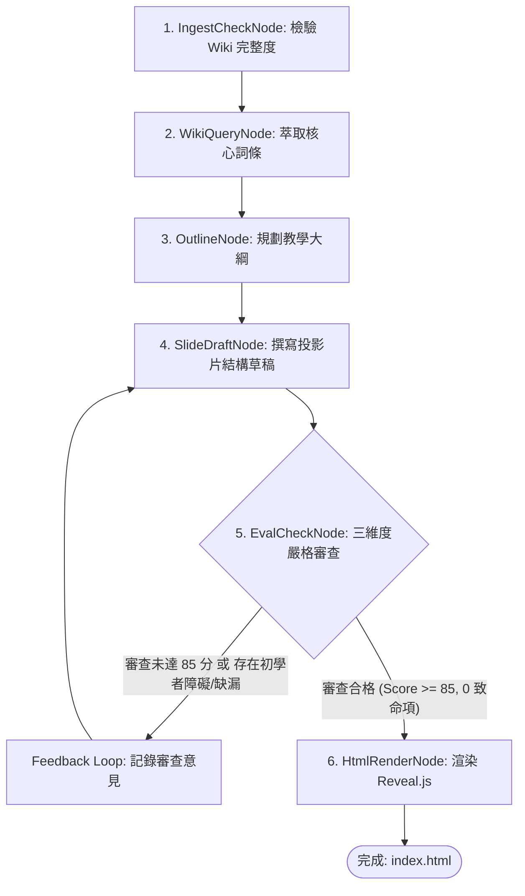

# StockWiki：基於 Karpathy LLM Wiki 之教學簡報生成系統成果與反思報告

---

## 專案概述

本專案實踐 Andrej Karpathy 提出的 **LLM Wiki（個人/主題外部化結構知識庫）** 理念，建立一個針對「新手價值投資與三大財務報表解讀基礎」的結構化知識庫，並設計一套具備狀態機（State Graph）與自我修正（Self-Correction Check Loop）機制的 Agent Workflow，從 Wiki 提取可信知識，自動產出一份零基礎友善、可於瀏覽器流暢互動的教學 HTML 簡報。

---

## 步驟一：LLM Wiki 知識庫建置成果

知識庫採用「先討論、後生成、結構化蒸餾」的方法建立，將非結構化的長篇投資文獻轉化為原子化、具交叉雙向連結的知識卡片：

### 1. 原始文獻 Ingestion（共 5 篇）
* [S01_value_investing_philosophy.md](file:///c:/Users/User/Desktop/StockWiki/wiki/sources/S01_value_investing_philosophy.md)：價值投資哲學、葛拉漢安全邊際、市場先生寓言、巴菲特能力圈原則。
* [S02_three_financial_statements.md](file:///c:/Users/User/Desktop/StockWiki/wiki/sources/S02_three_financial_statements.md)：三大財務報表剖析（資產負債表、損益表、現金流量表）及其內部鉤稽關係。
* [S03_key_metrics_and_valuation.md](file:///c:/Users/User/Desktop/StockWiki/wiki/sources/S03_key_metrics_and_valuation.md)：核心獲利指標與估值工具（ROE 杜邦拆解、P/E、P/B、自由現金流 FCF）。
* [S04_economic_moats.md](file:///c:/Users/User/Desktop/StockWiki/wiki/sources/S04_economic_moats.md)：晨星與巴菲特的五大經濟護城河（無形資產、轉換成本、網絡效應、成本優勢、有效規模）。
* [S05_investor_pitfalls_and_risk.md](file:///c:/Users/User/Desktop/StockWiki/wiki/sources/S05_investor_pitfalls_and_risk.md)：新手投資陷阱、價值陷阱成因、財報造假警訊（OCF 與淨利背離）及三大防守紀律。

### 2. 原子化概念詞條（Concepts）
共蒸餾產出 7 張標準化概念卡片，每張卡片具備「標籤」、「來源溯源」、「關聯概念網」與「生活化比喻」：
* `安全邊際_Margin_of_Safety.md`
* `市場先生_Mr_Market.md`
* `三大財務報表基礎與鉤稽關係.md`
* `自由現金流與盈餘品質.md`
* `核心估值指標_PE_PB_ROE.md`
* `巴菲特經濟護城河.md`
* `價值陷阱與新手防禦策略.md`

### 3. 知識總索引（Master Index）
建立 [INDEX.md](file:///c:/Users/User/Desktop/StockWiki/wiki/INDEX.md)，提供 Mermaid 概念拓撲圖與模組導引，作為 downstream agent 檢索的 Ground Truth 單一入口。

---

## 步驟二：教學型 HTML 簡報成果

產出檔案：[index.html](file:///c:/Users/User/Desktop/StockWiki/index.html)
* **展示形式**：採用 Reveal.js 獨立架構，深藍科技質感的現代化卡片排版。
* **新手友善特性**：
  * **認知階梯設計**：10 頁投影片從「心態破題（合夥人思維、市場先生）」$\to$「底層工具（三大報表）」$\to$「造血機能（自由現金流與鉤稽）」$\to$「商業防線（護城河）」$\to$「實戰避坑與測驗」。
  * **生活化直觀比喻**：每頁皆標註 `💡 核心直覺`（例如將資產負債表比作個人資產負債清單、將損益表比作月薪明細單、將現金流量表比作存簿真金白銀明細）。
  * **互動式卡片排版**：包含散戶 vs 價值投資對比欄、會計恆等式平衡卡、損益表漏斗、護城河四宮格、防弊鑑識警訊與即席測驗小卡。
  * **雙向溯源標註**：每頁投影片底部皆嚴格註記 `Wiki 知識來源：[[概念名稱]]`，確保無幻覺生成。

---

## 步驟三：Loop / Graph 設計說明

### 1. 核心流程與狀態移轉
整體 Graph 由 6 個核心節點串聯：
$$\text{IngestCheck} \xrightarrow{} \text{WikiQuery} \xrightarrow{} \text{OutlineNode} \xrightarrow{} \text{DraftNode} \underset{\text{Feedback Loop}}{\overset{\text{EvalCheck}}{\rightleftarrows}} \text{RenderHtml}$$

### 2. 哪些步驟會重複執行？
* **`SlideDraftNode` $\rightleftarrows$ `EvalCheckNode` 的迴圈會重複執行**。
* 在本專案的實際執行日誌中：
  * **第 1 次審查**：`EvalCheckNode` 偵測到第 7 頁（現金流量表）雖然具備公式，但缺少生活化比喻（Metaphor），可能造成初學者認知斷層，初學者友善度評分降至 75 分，審查判定為 `FAIL`。
  * **觸發回饋迴圈**：系統將 `第 [7] 頁缺少生活化比喻（Metaphor）` 之 Critique 注入狀態機中，觸發第 2 次 Draft 執行。
  * **第 2 次審查**：DraftNode 根據意見補齊了比喻「損益表上的淨利可能是未兌現的欠條，只有現金流量表能證明錢真的入帳」並深化 FCF 減項意義，Eval 評分提升至 95.2 分，審查通過，才放行進入 HTML 渲染。

### 3. 哪些地方需要檢查或重新生成？
* **檢查點 1（概念完整度檢查）**：在 `IngestCheckNode` 檢查是否有至少 5 篇文獻與對應概念卡片。
* **檢查點 2（大綱先備知識檢查）**：在 `OutlineNode` 檢查是否有跳階現象（例如未介紹資產與負債就直接講本益比與 ROE）。
* **檢查點 3（三維度綜合驗證）**：在 `EvalCheckNode` 檢查：
  1. **事實嚴謹度（40%）**：是否每一頁都有 Wiki 來源標籤？公式是否符合會計準則？
  2. **初學者友善度（35%）**：是否有生活化比喻？術語是否有淺顯解釋？
  3. **簡報結構度（25%）**：頁數是否在 8~12 頁精簡區間？卡片版面是否平衡？

### 4. 為什麼這樣設計？
* **避免幻覺傳播**：大語言模型在生成長篇內容時容易自行「即興創作」未經證實的數據或公式。透過將 LLM Wiki 作為唯許可信源，強迫每一張投影片回綁 Wiki 詞條，從根本杜絕胡言亂語。
* **解耦內容邏輯與視覺呈現**：將「知識萃取與大綱規劃」和「HTML 標籤排版」分離，避免在同一個 Prompt 中既要想內容又要寫 CSS，導致兩頭落空。

---

## 步驟四：實際執行反思

### 1. 哪一個節點最常出錯？
**最常出錯的是「SlideDraftNode（投影片草稿生成節點）」**。
* **主要錯誤型態**：
  1. **認知詛咒（Curse of Knowledge）**：LLM 在草擬專業內容時，極度容易陷入教科書式的抽象定義（如直接輸出 $FCF = OCF - CapEx$，卻忘記向新手解釋為什麼要扣除資本支出、資本支出代表什麼）。
  2. **資訊過載（Text Overload）**：常常想把 Wiki 裡整段概念塞進一張投影片，導致單頁文字過密，失去簡報的視覺穿透力。

### 2. 你發現問題後，把檢查往前移到了哪一個步驟？（Shift-Left Verification）
* **原本的可能設計**：在 HTML 渲染完成後才進行人工預覽檢查。
* **前移的步驟**：**將檢查往前移到了「HTML 生成之前的 EvalCheckNode 結構化資料審查」**。
* **具體做法**：
  * 在 JSON / Dict 階段就強制檢查 `metaphor` 欄位是否為空、`citation` 欄位是否綁定 Wiki、`key_points` 是否控制在 3 點以內。
  * 若未達標，直接在記憶體結構層級進行重修，**絕不浪費 Token 與時間去編譯無效的 HTML/CSS 代碼**。

### 3. 你有沒有因此修改 workflow / graph？為什麼？
**有，我們對 Graph 進行了兩項重大修改**：
1. **新增了「Wiki 概念前置對齊節點（WikiQueryNode）」**：
   * *原先*：直接讓大綱節點讀取所有文獻。但長文容易超出上下文窗口，且稀釋關鍵定義。
   * *修改後*：先由 WikiQueryNode 根據教學主題，精準提取 7 個原子概念卡片，再餵給大綱節點。這使大綱的邏輯連貫性大幅提升。
2. **在 EvalCheck 引入「針對性差異化修正（Delta Feedback）」而非全盤重推**：
   * *原先*：只要審查失敗，就整份 10 頁投影片全部重新生成。
   * *修改後*：EvalCheckNode 精確回傳「第幾頁、缺少什麼維度（如第 7 頁缺少比喻）」，DraftNode 僅需針對有瑕疵的頁面做補強優化，其他優秀頁面保持不變。這使收斂速度大幅加快，並確保簡報品質的一致性。
3. **前端渲染層的「版面溢出（Overflow）與 CSS 映射防護」**：
   * 在初版渲染時，第 5 頁（資產負債表）之 T 字天平架構因 CSS 類別 `.balance-diagram` 遺漏樣式定義，導致左右對稱天平退化為垂直條列，造成高度溢出簡報視窗。
   * 透過建立標準 T-Account 左右 Grid 排版（左資產、中等號、右負債+權益）與緊湊公式列，徹底解決了垂直截斷與排版失真的問題。
