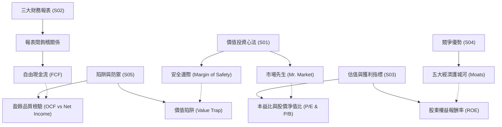

# StockWiki 知識庫總索引（Master Index）

> **知識庫定位**：新手價值投資與三大財務報表解讀基礎知識庫（依據 Karpathy LLM Wiki 架構整理）  
> **更新時間**：2026-11-23  
> **版本**：v1.0-structured

---

## 一、原始文獻來源庫（Sources Ingested）

| 編號 | 文獻名稱 | 核心主題 | 關聯概念標籤 |
| :--- | :--- | :--- | :--- |
| **S01** | [S01_value_investing_philosophy.md](sources/S01_value_investing_philosophy.md) | 價值投資哲學、葛拉漢三大心法、巴菲特能力圈 | #安全邊際 #市場先生 #內在價值 |
| **S02** | [S02_three_financial_statements.md](sources/S02_three_financial_statements.md) | 三大財務報表結構（資產負債表、損益表、現金流表）與鉤稽 | #資產負債表 #損益表 #現金流量表 |
| **S03** | [S03_key_metrics_and_valuation.md](sources/S03_key_metrics_and_valuation.md) | 核心獲利指標與估值工具（ROE、杜邦分析、P/E、P/B、FCF） | #ROE #本益比 #自由現金流 |
| **S04** | [S04_economic_moats.md](sources/S04_economic_moats.md) | 晨星五大經濟護城河（品牌、轉換成本、網絡效應、成本、規模） | #護城河 #定價權 #超額利潤 |
| **S05** | [S05_investor_pitfalls_and_risk.md](sources/S05_investor_pitfalls_and_risk.md) | 新手避坑指南、價值陷阱辨識、財報造假警訊與資產配置防線 | #價值陷阱 #盈餘品質 #風險管理 |

---

## 二、原子化概念網絡（Concept Network）

---

## 三、概念卡片索引（Atomic Concept Cards）

1. **[[安全邊際_Margin_of_Safety]]**：葛拉漢投資基石，內在價值與價格的折價緩衝空間。
2. **[[市場先生_Mr_Market]]**：情緒化報價的合夥人，投資人應當利用他而非被他牽著走。
3. **[[三大財務報表基礎與鉤稽關係]]**：快照（資產負債表）+ 成績單（損益表）+ 真金白銀（現金流量表）的有機循環。
4. **[[自由現金流與盈餘品質]]**：真假利潤的試金石，營業現金流長年大於淨利才是健康企業。
5. **[[核心估值指標_PE_PB_ROE]]**：ROE 衡量賺錢效率、P/E 衡量回本年限、P/B 衡量資產安全墊。
6. **[[巴菲特經濟護城河]]**：保護企業高利潤城堡的結構性優勢（無形資產、轉換成本、網絡效應、成本優勢、有效規模）。
7. **[[價值陷阱與新手防禦策略]]**：便宜不等於有安全邊際，辨識永久性衰退與防守三大紀律。
